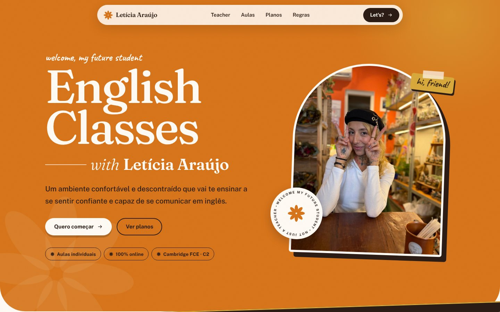

# Letícia Araújo · English Classes

Landing page e identidade de marca para uma professora de inglês. O ponto de partida foi um PDF de apresentação (“Teacher pitch”) e o perfil do Instagram dela; o resultado é um site estático, rápido e responsivo, sem framework e sem build.



## O que tem aqui

| Arquivo | O que é |
|---|---|
| `index.html` | Landing page: hero, trajetória, como funcionam as aulas, planos, regras e contato |
| `brand.html` | Guia de identidade: símbolo, logo, paleta, tipografia, voz e exemplos de post/story |
| `styles.css` | Design tokens (variáveis CSS) e todos os componentes |
| `script.js` | Revelação ao rolar, nav que esconde ao descer e alternador R$ / € nos planos |
| `fonts/` | Fraunces, Public Sans e Caveat (OFL), hospedadas localmente |
| `assets/` | Fotos otimizadas e favicon |

## Decisões de design

**Problema:** o link na bio de hoje é uma lista de botões, igual à de qualquer perfil. O pitch em PDF tinha conteúdo bom, mas ficava preso ao formato de documento.

**Solução:** transformar o pitch em uma página com personalidade própria, mantendo o que já era reconhecível (laranja, argila, sálvia, creme e a flor do selo “welcome my future student”).

- **Hero** em laranja, com foto em arco, selo giratório e adesivo: acolhedor, não institucional.
- **Faixa em movimento** com o lema “not just an English teacher”.
- **Planos com alternador R$ / €**: o pitch lista os dois valores; a página mostra um por vez e lembra a escolha.
- **Pagamento explicado em linha do tempo** (aulas começam em 1 fev, primeiro pagamento em 5 mar), em vez de um parágrafo.
- **Acessibilidade:** texto de leitura sempre em espresso sobre as cores quentes (contraste mínimo 5:1); creme sobre laranja só em títulos grandes; foco visível; `prefers-reduced-motion` respeitado; HTML semântico.

## Identidade

| Cor | Hex | Uso |
|---|---|---|
| Laranja Sidney | `#D8751B` | Cor principal |
| Espresso | `#2B1D16` | Texto e modo escuro |
| Creme | `#FFFBF5` | Fundo |
| Areia | `#F4E9DB` | Superfícies |
| Argila | `#C2A493` | Apoio |
| Sálvia | `#B4BA8F` | Apoio |
| Mostarda | `#D9A93B` | Destaque |
| Coral Veneza | `#E58A6B` | Só em redes sociais |

Tipografia: **Fraunces** (títulos), **Public Sans** (texto) e **Caveat** (bilhetes). Detalhes completos em `brand.html`.

## Rodar localmente

Não precisa instalar nada. Abra `index.html` no navegador, ou, para simular um servidor:

```bash
python3 -m http.server 8000
# http://localhost:8000
```

## Publicar no GitHub Pages

1. Crie um repositório e suba esta pasta (o `.nojekyll` já está incluído).
2. Em **Settings → Pages**, escolha **Deploy from a branch**, branch `main`, pasta `/ (root)`.
3. O site fica em `https://SEU-USUARIO.github.io/NOME-DO-REPO/`.

## Para editar o conteúdo

- Preços: atributos `data-brl` e `data-eur` em cada `.price` no `index.html`.
- Contato: o número do WhatsApp (`5519988221680`) e os links de Instagram e LinkedIn estão na seção `#contact`.
- Cores: variáveis no topo do `styles.css`.

## Créditos

Texto e fotos: material de divulgação de Letícia Araújo. Design e código: Nanda Monteiro.


